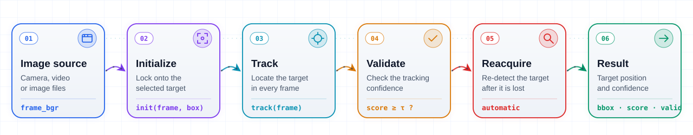

<div align="center">

<a href="https://viaitec.com/products/viaitracker/?utm_source=github&utm_medium=readme"></a>

# ViAiTracker

**C++ core library for real-time, long-term, high-accuracy visual object tracking**

**200+ FPS** on NVIDIA GPUs · **100+ FPS** on 2-6 TOPS edge devices · Windows · macOS · Linux · ARM64

[](https://viaitec.com/products/viaitracker/?utm_source=github&utm_medium=readme&utm_content=badge)
[](https://viaitec.com/products/viaitracker/?utm_source=github&utm_medium=readme&utm_content=badge#request-demo)
[](https://www.youtube.com/@viaitec)

[Website](https://viaitec.com/products/viaitracker/?utm_source=github&utm_medium=readme) ·
[Demo videos](#demo-videos) ·
[Integration](#c-integration) ·
[Request a demo](https://viaitec.com/products/viaitracker/?utm_source=github&utm_medium=readme#request-demo) ·
[Tiếng Việt](README.vi.md)

</div>

---

## Overview

The ViAiTracker object tracking library is built on artificial intelligence, with its core algorithm optimized for modern hardware accelerators such as NVIDIA GPUs and NPU-accelerated embedded hardware. Tests show that ViAiTracker achieves high accuracy, reaching **200+ FPS on NVIDIA GPUs** and **100+ FPS on embedded hardware with 2-6 TOPS** of compute acceleration. Ready to integrate into your system.

👉 Full details, videos and documentation on the product page: **[viaitec.com/products/viaitracker](https://viaitec.com/products/viaitracker/?utm_source=github&utm_medium=readme&utm_content=intro)**

| | |
|---|---|
| **200+ FPS** | on NVIDIA GPU systems |
| **100+ FPS** | on compact 2-6 TOPS edge devices |
| **Cross-platform** | Windows · macOS · Linux · ARM64 |

## Features

| | Feature | Demo |
|---|---|---|
| 01 | **Track the target continuously across frames**<br>Keeps a stable lock on the target over long sequences, handling scale change, fast motion and camera movement without drifting to the background | [▶ Watch](https://youtu.be/kVrCJJQSZyQ) |
| 02 | **Precisely track the target**<br>Tight, frame-accurate bounding boxes give downstream loops - gimbal control, autopilot guidance or analytics - clean, low-jitter measurements | [▶ Watch](https://youtu.be/y_5oa1Iz70c) |
| 03 | **Automatically reacquire lost targets**<br>When the target is occluded or leaves the frame, ViAiTracker reports the loss and re-detects the same target the moment it comes back - no manual re-selection needed | [▶ Watch](https://youtu.be/OmcgvN-hQf0) |
| 04 | **Robust target tracking, even in thermal imagery**<br>Works on thermal (IR) as well as visible-light video, keeping the lock at night, in low light and through haze | [▶ Watch](https://youtu.be/Ezan5L2SIQc) |
| 05 | **Tracks the target even when it is very small**<br>Keeps a stable lock on distant targets that occupy only a few pixels in the frame, making it well suited to long-range observation | [▶ Watch](https://youtu.be/10Iiylj-MfI) |
| 06 | **Runs in real time on resource-constrained embedded hardware**<br>Optimized for compact ARM64 boards with only 2-6 TOPS of compute, ViAiTracker keeps 100+ FPS real-time tracking right on the device - no PC or cloud connection required | [▶ Watch](https://youtu.be/mm-Jg6TrjIU) |

## How it works

Every frame goes through these steps: the tracker locks onto the selected target, locates it in each frame, checks the tracking confidence and automatically reacquires the target when it is lost.

<picture>
  <source media="(prefers-color-scheme: dark)" srcset="assets/flow-en-dark.svg">
  
</picture>

## Demo videos

Real footage processed by ViAiTracker. Click a thumbnail to watch on YouTube.

| | | | | |
|:-:|:-:|:-:|:-:|:-:|
| [](https://youtu.be/kVrCJJQSZyQ)<br>1 · Small target among clouds | [](https://youtu.be/y_5oa1Iz70c)<br>2 · Mountain biker | [](https://youtu.be/y_Zb0YK5Meg)<br>3 · Aircraft against clouds | [](https://youtu.be/OmcgvN-hQf0)<br>4 · Vehicle, aerial view | [](https://youtu.be/z3bg5W5rJsU)<br>5 · Aircraft with contrail |
| [](https://youtu.be/L30zCFI0vWo)<br>6 · Aircraft through clouds | [](https://youtu.be/urP6AqqZN7w)<br>7 · Tiny target in blue sky | [](https://youtu.be/Wvz63dRwmn8)<br>8 · Drone near buildings | [](https://youtu.be/10Iiylj-MfI)<br>9 · Tiny target in haze | [](https://youtu.be/P6KDNgyAcMo)<br>10 · Drone over rooftops |
| [](https://youtu.be/Ezan5L2SIQc)<br>11 · Target in infrared | [](https://youtu.be/QbvvUpiXuS0)<br>12 · Small target in infrared | [](https://youtu.be/I7JLpxvI-Ok)<br>13 · Infrared small-target tracking | [](https://youtu.be/-RIS-asWm_E)<br>14 · Small target with high maneuverability | [](https://youtu.be/mm-Jg6TrjIU)<br>15 · Target tracking on ARM platform |

More on the [VIAITEC YouTube channel](https://www.youtube.com/@viaitec).

## Supported platforms

| Platform | Toolchain | Static library |
|---|---|---|
| **Windows** | Visual Studio 2019 / 2022 (MSVC), x64 - build your application in the Release configuration | `ViAiTracker.lib` |
| **Linux** | GCC / Clang, x86_64 or ARM64 (embedded boards) - use the file built for your CPU architecture | `libViAiTracker.a` |
| **macOS** | Apple Clang, Apple Silicon and Intel (universal binary) | `libViAiTracker.a` |

Dependency: OpenCV.

## C++ integration

### 1. Add the header and static library to your CMake project

```cmake
cmake_minimum_required(VERSION 3.16)
project(my_app CXX)
set(CMAKE_CXX_STANDARD 17)
set(CMAKE_CXX_STANDARD_REQUIRED ON)

find_package(OpenCV REQUIRED)

# Folder containing ViAiTracker.h and the static library
# (ViAiTracker.lib on Windows, libViAiTracker.a on Linux / macOS)
set(VIAI_DIR ${CMAKE_SOURCE_DIR}/third_party/ViAiTracker)
if(WIN32)
    set(VIAI_LIB ${VIAI_DIR}/ViAiTracker.lib)
else()
    set(VIAI_LIB ${VIAI_DIR}/libViAiTracker.a)
endif()
if(NOT EXISTS ${VIAI_LIB})
    message(FATAL_ERROR "${VIAI_LIB} not found")
endif()

# Wrap the prebuilt static library as a CMake target
add_library(ViAiTracker STATIC IMPORTED)
set_target_properties(ViAiTracker PROPERTIES
    IMPORTED_LOCATION             ${VIAI_LIB}
    INTERFACE_INCLUDE_DIRECTORIES ${VIAI_DIR}
    INTERFACE_LINK_LIBRARIES      "${OpenCV_LIBS}")

add_executable(my_app main.cpp)
target_link_libraries(my_app PRIVATE ViAiTracker)
```

### 2. Initialize the tracker, select the target and track every frame

```cpp
#include "ViAiTracker.h"
#include <opencv2/videoio.hpp>

int main()
{
    // Initialization (models are loaded once)
    ViAi::ViAiConfig cfg;
    cfg.modelsDir    = "/path/to/models";
    cfg.modelVersion = "V1";               // "V1" or "V2"
    cfg.core_mask    = ViAi::CoreMask::All;
    ViAi::ViAiTracker tracker(cfg);

    cv::VideoCapture cap("input.mp4");
    cv::Mat frame_bgr;
    cap.read(frame_bgr);

    // Select the target (once, after the user clicks on it)
    float x = 420, y = 260, w = 64, h = 48;
    tracker.init(frame_bgr, cv::Rect2f(x, y, w, h));

    // Tracking loop (every frame)
    while (cap.read(frame_bgr)) {
        ViAi::ViAiResult r = tracker.track(frame_bgr);
        if (r.valid) {
            // r.bbox  - target position (x, y, w, h)
            // r.score - confidence [0, 1]
        }
    }
    return 0;
}
```

### 3. Configuration and result structures

```cpp
struct ViAiConfig {
    std::string modelsDir     = ".";
    std::string modelVersion  = "V1";  // "V1" or "V2"
    CoreMask    core_mask     = CoreMask::All;
};

struct ViAiResult {
    cv::Rect2f bbox;           // target position (x, y, w, h) - pixels
    float      score = 0.f;    // confidence ~[0, 1]
    bool       valid = false;  // false until init() has been called
};
```

### 4. Best practices

- Create the `ViAiTracker` once when the application starts (models are loaded from `modelsDir`) and reuse it.
- Call `init()` once after the user selects the target, then `track()` on every BGR frame.
- Check `r.valid` (false until `init()` has been called) and `r.score` on every result.

## Get ViAiTracker

ViAiTracker is distributed as a prebuilt SDK. To evaluate it on your own hardware and footage, [request a demo](https://viaitec.com/products/viaitracker/?utm_source=github&utm_medium=readme#request-demo) - our engineers will prepare an evaluation package for your target platform (GPU or edge device), together with technical consultation and a performance report on your own video samples.

## Contact

**VIAITEC** - Vietnamese AI Technology

- Website: [viaitec.com](https://viaitec.com/?utm_source=github&utm_medium=readme)
- Email: [info@viaitec.com](mailto:info@viaitec.com)
- Phone: +84 974 139 366

<sub>© <a href="https://viaitec.com/?utm_source=github&utm_medium=readme&utm_content=footer">VIAITEC</a>. All rights reserved.</sub>
