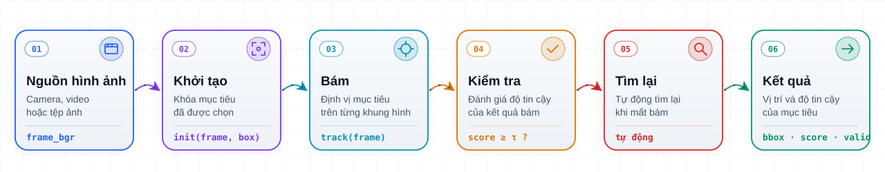

<div align="center">

<a href="https://viaitec.com/vi/products/viaitracker/?utm_source=github&utm_medium=readme"></a>

# ViAiTracker

**Thư viện lõi C++ bám mục tiêu thị giác thời gian thực, dài hạn và độ chính xác cao**

**200+ FPS** trên GPU NVIDIA · **100+ FPS** trên thiết bị biên 2-6 TOPS · Windows · macOS · Linux · ARM64

[](https://viaitec.com/vi/)
[](https://viaitec.com/vi/products/viaitracker/)
[](https://viaitec.com/vi/products/viaitracker/?utm_source=github&utm_medium=readme&utm_content=badge#request-demo)
[](https://www.youtube.com/@viaitec)

[Website](https://viaitec.com/vi/products/viaitracker/?utm_source=github&utm_medium=readme) ·
[Video demo](#video-demo) ·
[Tích hợp](#tích-hợp-c) ·
[Yêu cầu demo](https://viaitec.com/vi/products/viaitracker/?utm_source=github&utm_medium=readme#request-demo) ·
[English](README.md)

</div>

---

## Giới thiệu

Thư viện bám đối tượng ViAiTracker được phát triển dựa trên trí tuệ nhân tạo, lõi của thuật toán được tối ưu theo các phần cứng hỗ trợ tăng tốc tính toán hiện đại như NVIDIA GPUs và phần cứng nhúng có hỗ trợ tăng tốc NPU. Các thử nghiệm cho thấy ViAiTracker có độ chính xác cao, đạt **200+ fps trên Nvidia GPUs** và **100+ fps trên các phần cứng nhúng** có hỗ trợ tăng tốc tính toán 2-6 TOPS. Sẵn sàng tích hợp vào hệ thống của bạn.

👉 Xem chi tiết, video và tài liệu tại trang sản phẩm: **[viaitec.com/vi/products/viaitracker](https://viaitec.com/vi/products/viaitracker/?utm_source=github&utm_medium=readme&utm_content=intro)**

| | |
|---|---|
| **200+ FPS** | trên hệ thống GPU NVIDIA |
| **100+ FPS** | trên thiết bị biên 2-6 TOPS |
| **Đa nền tảng** | Windows · macOS · Linux · ARM64 |

## Tính năng

| | Tính năng | Demo |
|---|---|---|
| 01 | **Bám mục tiêu liên tục qua các khung hình**<br>Giữ khóa ổn định trên mục tiêu trong chuỗi video dài, xử lý thay đổi kích thước, chuyển động nhanh và rung lắc camera mà không bị trôi sang nền | [▶ Xem](https://youtu.be/kVrCJJQSZyQ) |
| 02 | **Bám chính xác mục tiêu trên từng khung hình**<br>Khung bao sát, chính xác trên từng khung hình giúp các khâu điều khiển phía sau - bộ ổn định camera (gimbal), hệ lái tự động hay phân tích hình ảnh - nhận số liệu sạch, ít dao động | [▶ Xem](https://youtu.be/y_5oa1Iz70c) |
| 03 | **Tự động bám lại mục tiêu ngay khi mục tiêu xuất hiện trở lại sau khi mất bám**<br>Khi mục tiêu bị che khuất hoặc ra khỏi khung hình, ViAiTracker báo mất bám và phát hiện lại đúng mục tiêu ngay khi nó quay lại - không cần chọn lại thủ công | [▶ Xem](https://youtu.be/OmcgvN-hQf0) |
| 04 | **Bám mục tiêu ổn định, kể cả trên ảnh nhiệt**<br>Hoạt động trên video ảnh nhiệt (IR) lẫn ảnh thường, giữ khóa mục tiêu vào ban đêm, thiếu sáng và trong sương mù | [▶ Xem](https://youtu.be/Ezan5L2SIQc) |
| 05 | **Bám đối tượng ngay cả khi đối tượng rất nhỏ**<br>Giữ khóa ổn định trên mục tiêu ở xa chỉ chiếm vài điểm ảnh trong khung hình, phù hợp cho quan sát tầm xa | [▶ Xem](https://youtu.be/10Iiylj-MfI) |
| 06 | **Chạy thời gian thực trên phần cứng nhúng tài nguyên hạn chế**<br>Được tối ưu cho bo mạch ARM64 nhỏ gọn chỉ có 2-6 TOPS, ViAiTracker vẫn bám mục tiêu thời gian thực trên 100 FPS ngay trên thiết bị - không cần máy tính hay kết nối đám mây | [▶ Xem](https://youtu.be/mm-Jg6TrjIU) |

## Cách hoạt động

Mỗi khung hình đi qua các bước sau: bộ bám khóa mục tiêu đã chọn, định vị mục tiêu trên từng khung hình, kiểm tra độ tin cậy và tự động tìm lại khi mất bám.

<picture>
  <source media="(prefers-color-scheme: dark)" srcset="assets/flow-vi-dark.svg">
  
</picture>

## Video demo

Video thực tế được xử lý bởi ViAiTracker. Bấm vào ảnh để xem trên YouTube.

| | | | | |
|:-:|:-:|:-:|:-:|:-:|
| [](https://youtu.be/kVrCJJQSZyQ)<br>1 · Mục tiêu nhỏ giữa mây | [](https://youtu.be/y_5oa1Iz70c)<br>2 · Người đạp xe địa hình | [](https://youtu.be/y_Zb0YK5Meg)<br>3 · Máy bay trên nền mây | [](https://youtu.be/OmcgvN-hQf0)<br>4 · Phương tiện nhìn từ trên cao | [](https://youtu.be/z3bg5W5rJsU)<br>5 · Máy bay có vệt khói |
| [](https://youtu.be/L30zCFI0vWo)<br>6 · Máy bay xuyên mây | [](https://youtu.be/urP6AqqZN7w)<br>7 · Mục tiêu nhỏ trên nền trời xanh | [](https://youtu.be/Wvz63dRwmn8)<br>8 · Drone gần tòa nhà | [](https://youtu.be/10Iiylj-MfI)<br>9 · Mục tiêu nhỏ trong sương mờ | [](https://youtu.be/P6KDNgyAcMo)<br>10 · Drone trên mái nhà |
| [](https://youtu.be/Ezan5L2SIQc)<br>11 · Mục tiêu trong ảnh hồng ngoại | [](https://youtu.be/QbvvUpiXuS0)<br>12 · Mục tiêu nhỏ trong ảnh hồng ngoại | [](https://youtu.be/I7JLpxvI-Ok)<br>13 · Bám mục tiêu nhỏ trên ảnh hồng ngoại | [](https://youtu.be/-RIS-asWm_E)<br>14 · Mục tiêu nhỏ với độ cơ động cao | [](https://youtu.be/mm-Jg6TrjIU)<br>15 · Bám đối tượng trên nền tảng phần cứng nhúng |

Xem thêm trên [kênh YouTube VIAITEC](https://www.youtube.com/@viaitec).

## Nền tảng hỗ trợ

| Nền tảng | Trình biên dịch | Thư viện tĩnh |
|---|---|---|
| **Windows** | Visual Studio 2019 / 2022 (MSVC), x64 - build ứng dụng ở cấu hình Release để khớp với thư viện | `ViAiTracker.lib` |
| **Linux** | GCC / Clang, x86_64 hoặc ARM64 (bo mạch nhúng) - dùng đúng file được build cho kiến trúc CPU của máy | `libViAiTracker.a` |
| **macOS** | Apple Clang, Apple Silicon và Intel (bản universal) | `libViAiTracker.a` |

Thư viện phụ thuộc: OpenCV.

## Tích hợp C++

### 1. Thêm header và thư viện tĩnh vào dự án CMake

```cmake
cmake_minimum_required(VERSION 3.16)
project(my_app CXX)
set(CMAKE_CXX_STANDARD 17)
set(CMAKE_CXX_STANDARD_REQUIRED ON)

find_package(OpenCV REQUIRED)

# Thư mục chứa ViAiTracker.h và thư viện tĩnh
# (ViAiTracker.lib trên Windows, libViAiTracker.a trên Linux / macOS)
set(VIAI_DIR ${CMAKE_SOURCE_DIR}/third_party/ViAiTracker)
if(WIN32)
    set(VIAI_LIB ${VIAI_DIR}/ViAiTracker.lib)
else()
    set(VIAI_LIB ${VIAI_DIR}/libViAiTracker.a)
endif()
if(NOT EXISTS ${VIAI_LIB})
    message(FATAL_ERROR "Không tìm thấy ${VIAI_LIB}")
endif()

# Đóng gói thư viện tĩnh có sẵn thành một target CMake
add_library(ViAiTracker STATIC IMPORTED)
set_target_properties(ViAiTracker PROPERTIES
    IMPORTED_LOCATION             ${VIAI_LIB}
    INTERFACE_INCLUDE_DIRECTORIES ${VIAI_DIR}
    INTERFACE_LINK_LIBRARIES      "${OpenCV_LIBS}")

add_executable(my_app main.cpp)
target_link_libraries(my_app PRIVATE ViAiTracker)
```

### 2. Khởi tạo bộ bám, chọn mục tiêu và bám trên từng khung hình

```cpp
#include "ViAiTracker.h"
#include <opencv2/videoio.hpp>

int main()
{
    // Khởi tạo (load model một lần)
    ViAi::ViAiConfig cfg;
    cfg.modelsDir    = "/path/to/models";
    cfg.modelVersion = "V1";               // "V1" hoặc "V2"
    cfg.core_mask    = ViAi::CoreMask::All;
    ViAi::ViAiTracker tracker(cfg);

    cv::VideoCapture cap("input.mp4");
    cv::Mat frame_bgr;
    cap.read(frame_bgr);

    // Chọn mục tiêu (1 lần sau khi người dùng click)
    float x = 420, y = 260, w = 64, h = 48;
    tracker.init(frame_bgr, cv::Rect2f(x, y, w, h));

    // Vòng lặp track (mỗi frame)
    while (cap.read(frame_bgr)) {
        ViAi::ViAiResult r = tracker.track(frame_bgr);
        if (r.valid) {
            // r.bbox  - vị trí mục tiêu (x, y, w, h)
            // r.score - độ tin cậy [0, 1]
        }
    }
    return 0;
}
```

### 3. Cấu trúc cấu hình và kết quả

```cpp
struct ViAiConfig {
    std::string modelsDir     = ".";
    std::string modelVersion  = "V1";  // V1 hoặc V2
    CoreMask    core_mask     = CoreMask::All;
};

struct ViAiResult {
    cv::Rect2f bbox;           // vị trí mục tiêu (x, y, w, h) - pixel
    float      score = 0.f;    // độ tin cậy ~[0, 1]
    bool       valid = false;  // false trước khi gọi init()
};
```

### 4. Lưu ý khi sử dụng

- Tạo đối tượng `ViAiTracker` một lần khi khởi động ứng dụng (mô hình được nạp từ `modelsDir`) và dùng lại cho các lần bám sau.
- Gọi `init()` một lần sau khi người dùng chọn mục tiêu, sau đó gọi `track()` trên mỗi khung hình ảnh màu BGR.
- Kiểm tra `r.valid` (bằng false khi chưa gọi `init()`) và `r.score` ở mỗi kết quả.

## Nhận ViAiTracker

ViAiTracker được cung cấp dưới dạng SDK đã biên dịch sẵn. Để đánh giá trên phần cứng và video của chính bạn, hãy [gửi yêu cầu demo](https://viaitec.com/vi/products/viaitracker/?utm_source=github&utm_medium=readme#request-demo) - đội ngũ kỹ sư sẽ chuẩn bị gói dùng thử cho nền tảng của bạn (GPU hoặc thiết bị biên), kèm tư vấn kỹ thuật và báo cáo hiệu năng trên video mẫu của bạn.

## Liên hệ

<div align="center">

**VIAITEC** - Công nghệ trí tuệ nhân tạo Việt

| **💬 Hỗ trợ** | **✉️ Email** | **🌐 Website** | **▶️ YouTube** |
|:-:|:-:|:-:|:-:|
| [viaitec.com/vi/contact](https://viaitec.com/vi/contact/) | [info@viaitec.com](mailto:info@viaitec.com) | [viaitec.com](https://viaitec.com/vi/) | [@viaitec](https://www.youtube.com/@viaitec) |

</div>

<sub>© <a href="https://viaitec.com/vi/?utm_source=github&utm_medium=readme&utm_content=footer">VIAITEC</a>. All rights reserved.</sub>
